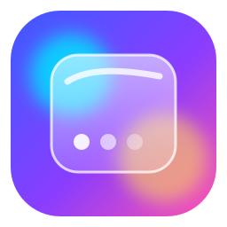
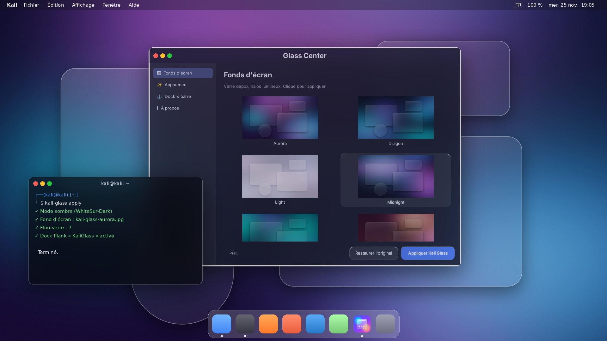
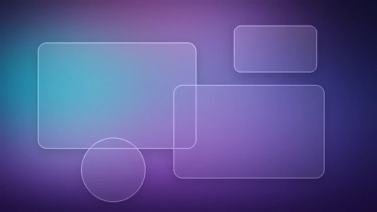

<div align="center">



# Kali Glass

**A macOS-style glass desktop for Kali Linux.**
Frosted-glass wallpapers · real-time blur · translucent menu bar · magnifying dock · settings app

[](https://github.com/ck526438-lgtm/kali-glass/actions/workflows/release.yml)
[](https://github.com/ck526438-lgtm/kali-glass/releases/latest)
[](LICENSE)


[Français](README.md) · **English**



<sub>Simulated preview. Real blur requires OpenGL (enable 3D acceleration in VMs).</sub>

</div>

---

## Features

- **6 frosted-glass 4K wallpapers** — Aurora, Dragon, Ocean, Sunset, Midnight, Light
- **Real-time blur** — picom `dual_kawase`, rounded corners, soft shadows, fades
- **macOS look** — WhiteSur GTK/icons/cursors, window buttons on the left, Inter font
- **Thin translucent top bar** with adjustable opacity
- **Dock** — Plank with a glass theme and 150% zoom; an XFCE-panel dock is created automatically if Plank is unavailable (it left Debian testing in 2026)
- **Animated 4K wallpapers** — any video (MP4, WebM, MKV, MOV, GIF) looping behind your windows, plus an official pack of 4 animated glass loops; auto-pause on fullscreen/maximized windows and on battery
- **Light / dark mode**, **time-of-day wallpaper**, **login screen** wallpaper
- **Exact rollback** — every setting is backed up before it changes; `kali-glass restore` puts everything back
- **Built-in diagnostics** — `kali-glass doctor` tells you what's missing and how to fix it

## Animated wallpapers

<div align="center"></div>

```bash
kali-glass live download              # official pack (4K or 1080p depending on your screen)
kali-glass live set aurora            # aurora · ocean · sunset · midnight
kali-glass live set ~/Videos/beach.mp4
kali-glass live toggle | stop
```

Right-click the animated desktop for a quick menu. XFCE desktop icons are hidden while a video plays.

## Install

```bash
# from source
git clone https://github.com/ck526438-lgtm/kali-glass.git
cd kali-glass && ./install.sh

# or the .deb from the latest release
sudo apt install ./kali-glass_*_all.deb
kali-glass apply      # no sudo: settings are per user
```

Log out and back in to finish.

## Usage

Open **Glass Center** from the menu, or use the CLI:

```bash
kali-glass apply | restore | status | doctor
kali-glass wallpaper ocean          # or a path to any image
kali-glass mode light|dark
kali-glass blur 0-20
kali-glass panel-opacity 0-100
kali-glass dock on|off
kali-glass dynamic on|off
sudo kali-glass login
```

Full reference: `man kali-glass`. Logs: `~/.cache/kali-glass/kali-glass.log`.

## Development

```bash
make test    # ruff + shellcheck + pytest (no desktop needed, xfconf is mocked)
make deb
```

See [CONTRIBUTING.md](CONTRIBUTING.md) (French). Bump `VERSION` in `bin/kali-glass`, update `CHANGELOG.md`, push to `main` — CI tests, builds and publishes the release with `SHA256SUMS`.

## Credits

WhiteSur themes by [vinceliuice](https://github.com/vinceliuice/WhiteSur-gtk-theme) (downloaded at install time, not bundled) · [picom](https://github.com/yshui/picom) · [Plank](https://launchpad.net/plank).
Kali Glass is an independent project, not affiliated with OffSec or Apple.

MIT © ck526438-lgtm
