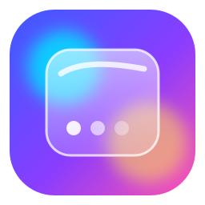
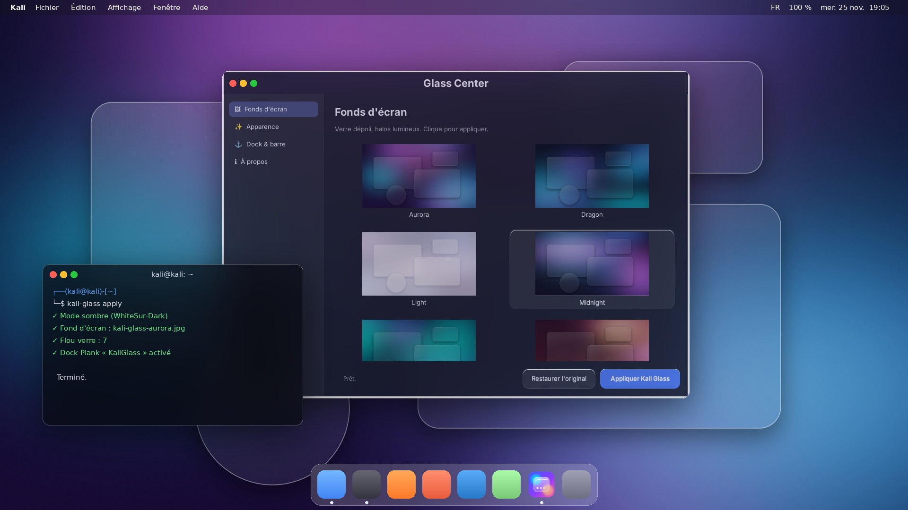
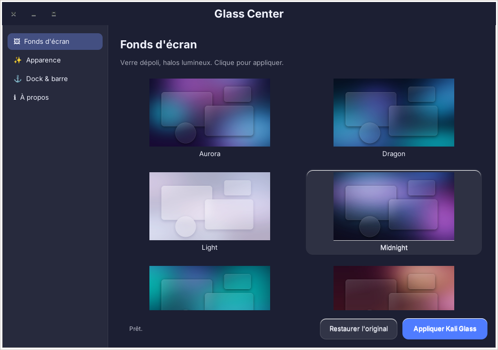

<div align="center">



# Kali Glass

**Le bureau Kali Linux en mode verre façon macOS.**
Fonds d'écran en verre dépoli · flou en temps réel · barre de menus translucide · dock avec effet loupe · appli de réglages



<sub>Aperçu simulé. Le rendu réel dépend de ta carte graphique (le flou demande OpenGL).</sub>

</div>

---

## ✨ Ce que ça change

| | |
|---|---|
| 🖼 **6 fonds d'écran 4K** | Aurora, Dragon, Ocean, Sunset, Midnight, Light. Verre dépoli et halos lumineux, générés par script |
| 🧊 **Flou « verre »** | `picom` avec flou `dual_kawase`, coins arrondis, ombres douces, fondus |
| 🍎 **Look macOS** | Thème GTK, icônes et curseurs WhiteSur, boutons fermer/réduire/agrandir à gauche, police Inter |
| ▭ **Barre du haut** | Fine (28 px), translucide, opacité réglable |
| ⚓ **Dock** | Plank avec thème verre « KaliGlass », zoom 150 %, masquage intelligent. Si plank n'est pas dispo (retiré de Debian testing en 2026), un dock XFCE translucide est créé à la place |
| 🌗 **Mode clair / sombre** | Un clic pour basculer |
| 🕒 **Fond dynamique** | Le fond change selon l'heure de la journée |
| 🔐 **Écran de connexion** | Fond Glass aussi sur LightDM (optionnel) |
| ↩ **Retour arrière** | `kali-glass restore` remet exactement tes anciens réglages |

## 🚀 Installation

### Option 1 : en une commande (recommandé)

```bash
git clone https://github.com/ck526438-lgtm/kali-glass.git
cd kali-glass
./install.sh            # ou ./install.sh --light pour démarrer en mode clair
```

### Option 2 : paquet .deb

Télécharge `kali-glass_1.0.0_all.deb` dans les [Releases](https://github.com/ck526438-lgtm/kali-glass/releases), puis :

```bash
sudo apt install ./kali-glass_1.0.0_all.deb
kali-glass apply        # sans sudo : les réglages sont propres à ton utilisateur
```

Déconnecte-toi puis reconnecte-toi pour que tout soit pris en compte.

## 🧭 Les apps

### Glass Center (graphique)

Menu → **Glass Center**, ou la commande `glass-center`.



- **Fonds d'écran** : galerie, ta propre image, fond dynamique
- **Apparence** : mode clair/sombre, intensité du flou, redémarrage du compositeur
- **Dock & barre** : activer le dock, opacité de la barre du haut
- **Appliquer Kali Glass** / **Restaurer l'original**

### kali-glass (ligne de commande)

```bash
kali-glass apply                 # applique tout
kali-glass list                  # liste les fonds
kali-glass wallpaper ocean       # change de fond (ou un chemin : ~/Images/photo.jpg)
kali-glass mode light            # mode clair (dark pour sombre)
kali-glass blur 9                # flou de 0 (désactivé) à 20
kali-glass panel-opacity 25      # opacité de la barre du haut, en %
kali-glass dock off              # désactive le dock
kali-glass dynamic on            # fond qui suit l'heure
sudo kali-glass login            # fond Glass sur l'écran de connexion
kali-glass restore               # remet tout comme avant
kali-glass status                # état actuel
```

## 🛠 Dépannage

| Problème | Solution |
|---|---|
| Pas de flou, juste de la transparence | Ta VM n'a pas l'accélération 3D. VirtualBox : *Affichage → Activer l'accélération 3D*. VMware : *Accelerate 3D graphics*. Kali Glass bascule tout seul sur `xrender` (sans flou) si OpenGL manque |
| Écran qui scintille | `kali-glass blur 0` puis relance, ou mets `vsync = false;` dans `~/.config/picom/kali-glass.conf` |
| Le thème WhiteSur n'est pas appliqué | `kali-glass install-themes` puis `kali-glass apply` |
| Le dock n'apparaît pas | `kali-glass dock on`. Pour avoir les icônes des applis ouvertes dans le dock XFCE : `sudo apt install xfce4-docklike-plugin` puis `kali-glass dock off && kali-glass dock on` |
| Je veux revenir à Kali d'origine | `kali-glass restore` ou `./uninstall.sh` |

## 📁 Structure

```
kali-glass/
├── apps/glass-center/      appli GTK « Glass Center » (+ icône, .desktop)
├── bin/kali-glass          outil en ligne de commande (Python)
├── config/
│   ├── picom/picom.conf    flou, ombres, coins arrondis
│   ├── plank/KaliGlass/    thème du dock en verre
│   └── gtk-3.0/            retouches GTK (menus, barre)
├── wallpapers/             6 fonds d'écran 4K
├── tools/                  générateurs des fonds et de l'aperçu
├── packaging/build-deb.sh  construit le paquet .deb
├── install.sh / uninstall.sh
└── .github/workflows/      CI : vérifie, construit le .deb, publie la release
```

Régénérer les fonds (autre résolution, par ex. 2560×1440) :

```bash
python3 tools/generate_wallpapers.py wallpapers 2560 1440
```

## 📦 Publier une version

```bash
git tag v1.0.0 && git push origin v1.0.0
```

GitHub Actions construit `kali-glass_1.0.0_all.deb` et `kali-glass-wallpapers.zip` et les attache à la release.

## 🙏 Crédits

- Thèmes GTK, icônes, curseurs : [WhiteSur](https://github.com/vinceliuice/WhiteSur-gtk-theme) par vinceliuice, téléchargés à l'installation et non inclus dans ce dépôt
- Compositeur : [picom](https://github.com/yshui/picom) · Dock : [Plank](https://launchpad.net/plank)

Kali Glass est un projet indépendant, sans lien avec Offensive Security ni Apple.

## 📄 Licence

MIT © ck526438-lgtm
